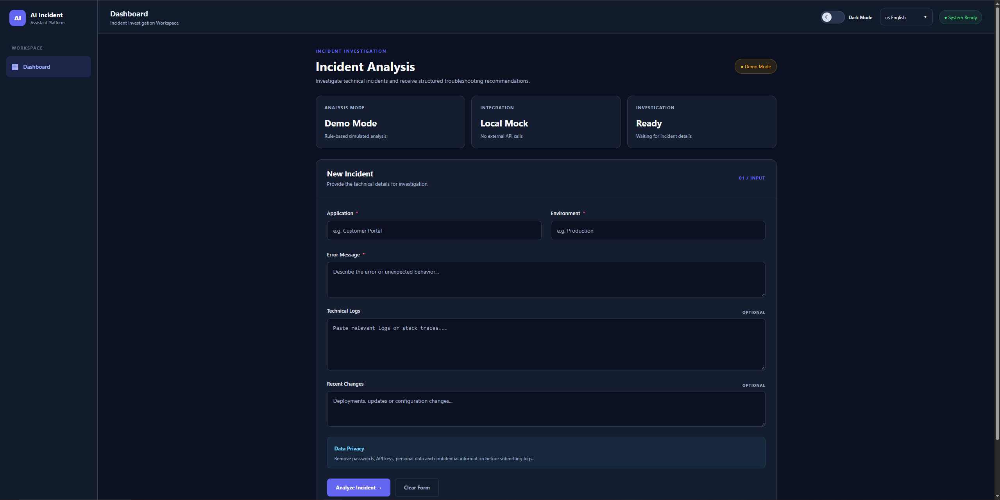
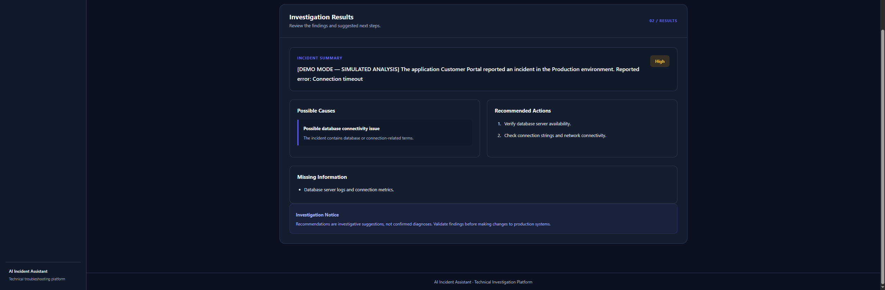
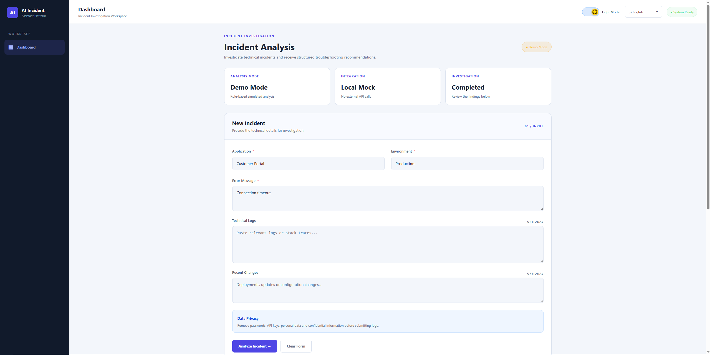
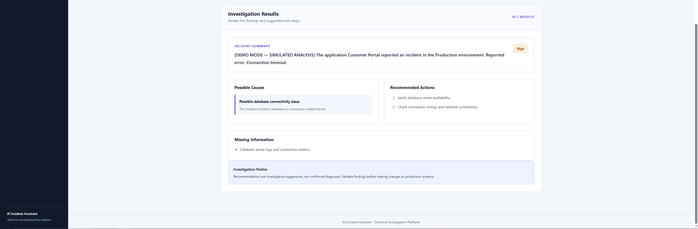

# AI Incident Assistant

**GitHub Repository:** [AI Incident Assistant](https://github.com/BurakkuBR/AIIncidentAssistant)

An ASP.NET Core web application designed to assist with technical incident investigation by organizing incident details and generating structured troubleshooting recommendations.

The project demonstrates backend development with C#, integration patterns for AI services, multilingual user interfaces, automated testing, and modern web application design.


## Screenshots

The application provides a responsive dashboard with Dark and Light themes.

### Dark Mode

**Incident submission**



**Investigation results**



### Light Mode

**Incident submission**



**Investigation results**



> All screenshots demonstrate the application's rule-based Demo Mode.
> No external AI service was used to generate these results.

---


## Features

- **Incident investigation:** Submit application details, environment information, error messages, technical logs, and recent changes.
- **Structured analysis:** View an incident summary, severity classification, possible causes, recommended actions, and missing information.
- **Demo Mode:** Explore the application without an external API key using a rule-based simulation.
- **Claude AI integration:** Includes a prepared integration with the Anthropic Messages API for AI-assisted analysis.
- **Multilingual interface:** Supports Brazilian Portuguese, English, and Spanish.
- **Dark and Light themes:** Responsive interface with persistent theme preferences.
- **Accessible language selector:** Animated dropdown with keyboard navigation.
- **Input validation:** Server-side validation with localized error messages.
- **Automated tests:** Unit tests for Claude response parsing and multilingual prompt generation.

## Tech Stack

| Area | Technology |
|---|---|
| Backend | C#, ASP.NET Core |
| Web framework | Razor Pages |
| Frontend | HTML, CSS, JavaScript, Bootstrap |
| AI integration | Anthropic Claude Messages API |
| Localization | ASP.NET Core Localization, RESX resources |
| Dependency injection | ASP.NET Core built-in DI container |
| Testing | xUnit |
| Development environment | Visual Studio 2022 |

## How It Works

The user submits information about a technical incident through a web form.

The application validates the input and delegates the investigation to an implementation of `IIncidentAnalysisService`.

Two analysis implementations are available:

### Demo Mode

`MockIncidentAnalysisService` generates predefined troubleshooting suggestions based on keywords found in the incident description and logs.

This mode is intended for demonstrations and local development.

**Demo Mode does not use artificial intelligence or make external API calls.**

### Claude AI Mode

`ClaudeIncidentAnalysisService` is designed to communicate with the Anthropic Messages API.

The integration includes:

- A prompt builder that requests structured JSON output.
- Instructions to avoid unsupported conclusions and identify missing information.
- Language-aware prompt generation.
- An HTTP client for Anthropic API requests.
- A JSON response parser.
- Error handling for API and response-processing failures.

**Note:** The Claude integration has been implemented but has not yet been validated with a live Anthropic API key.

## Project Structure

```text
AIIncidentAssistant/
├── AIIncidentAssistant/
│   ├── Configuration/
│   ├── Controllers/
│   ├── Localization/
│   ├── Models/
│   ├── Pages/
│   ├── Resources/
│   ├── Services/
│   │   └── Claude/
│   ├── wwwroot/
│   │   ├── css/
│   │   └── js/
│   └── Program.cs
├── AIIncidentAssistant.Tests/
├── .gitignore
└── README.md
```

## Getting Started

### Prerequisites

- A compatible .NET SDK for the target framework configured in the project.
- Visual Studio 2022 or another compatible .NET development environment.

### Run Locally

1. Clone the repository:

   ```bash
   git clone https://github.com/BurakkuBR/AIIncidentAssistant
   ```

2. Open the solution in Visual Studio.

3. Set `AIIncidentAssistant` as the startup project.

4. Confirm that `appsettings.Development.json` contains:

   ```json
   {
     "DemoMode": true
   }
   ```

5. Run the application using the development profile.

The application will start in Demo Mode, without requiring an Anthropic API key.

## Anthropic Configuration

To prepare the application for Claude AI Mode:

1. Store your Anthropic API key securely using .NET User Secrets or environment variables.
2. Configure the `Anthropic:ApiKey` and `Anthropic:Model` settings.
3. Set `DemoMode` to `false` in the appropriate configuration file.

Example User Secrets structure:

```json
{
  "Anthropic": {
    "ApiKey": "YOUR_API_KEY",
    "Model": "YOUR_SUPPORTED_MODEL"
  }
}
```

Never commit real API keys, credentials, or local secret files to source control.

## Running Tests

Run the automated tests using Visual Studio Test Explorer or the .NET CLI:

```bash
dotnet test
```

The test project covers:

- Parsing structured Claude API responses.
- Generating prompts for Brazilian Portuguese, English, and Spanish.
- Maintaining expected JSON output instructions.

## Security and Limitations

- API credentials should be stored outside source-controlled configuration files.
- Demo Mode provides simulated, rule-based responses rather than AI-generated analysis.
- AI-generated recommendations, when enabled, should be reviewed by a qualified person before taking action.
- Technical logs may contain sensitive information and should be reviewed before being submitted to an external AI service.
- The project is intended as a learning and portfolio application, not a production-ready incident management platform.

## Future Improvements

- Validate the Claude integration with live API requests.
- Expand automated test coverage.
- Add incident history and persistence.
- Improve observability and error reporting.
- Introduce additional incident classification and investigation features.

## Project Purpose

AI Incident Assistant was created as a portfolio project to explore practical software engineering concepts, including:

- Clean separation of responsibilities.
- Dependency injection and interface-based design.
- Integration with external AI services.
- Structured JSON processing.
- Localization and accessibility.
- Automated testing.
- AI-assisted software development workflows.

The project demonstrates how conventional backend engineering can be combined with AI integration patterns to support technical troubleshooting.